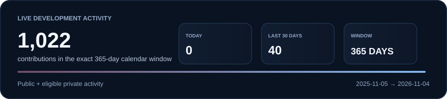
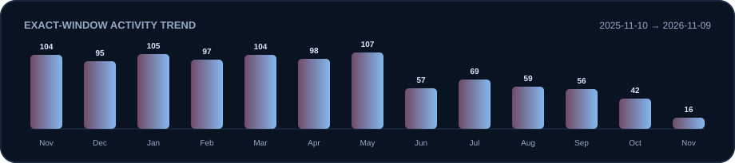
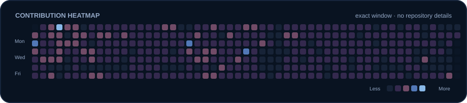
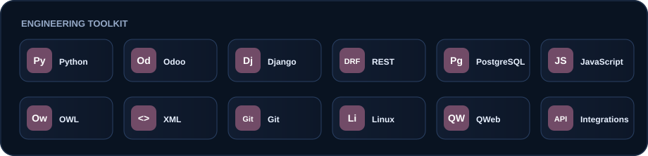

# Salah ElDin Saeed Abu Saif

### Software Engineer · Odoo ERP & Python Backend

**Building reliable ERP workflows, backend services, and practical business automation.**

I turn operational requirements into maintainable software—custom Odoo solutions, accounting and HR workflows, and Python/Django services backed by PostgreSQL.

[LinkedIn](https://www.linkedin.com/in/salah-abo-saif/) &nbsp;·&nbsp; [GitHub](https://github.com/salahsaeed19) &nbsp;·&nbsp; [Email](mailto:salahsaeed40@gmail.com)

## Live Development Activity

  

  

Counts come directly from GitHub GraphQL and describe contributions—not commits. The generated assets never display repository names, commit messages, or private project details.

## Contribution Heatmap

  

> Private activity is included only after the workflow verifies an owner-authenticated `read:user` token. Otherwise the cards show **Private inclusion unverified**; no private totals are guessed.

## Engineering Highlights

| Area | Focus |
| --- | --- |
| Smart PRO ERP | Odoo Community-based enhancements across workflows, reports, and business modules. |
| Odoo solutions | Custom Community and Enterprise delivery: modules, XML views, QWeb reports, and API integrations. |
| Migration & continuity | Version upgrades and data transfer designed to preserve business data and workflows. |
| Financial insight | Budget and analytic-accounting reports and dashboards for clearer operational control. |
| Workflow automation | HR training, employee history, and business processes streamlined through Odoo. |
| Backend systems | Python, Django, and DRF services with PostgreSQL and Linux deployment experience. |

## Tech Stack

  

Python · Odoo · Django · Django REST Framework · PostgreSQL · JavaScript · OWL · XML · Git · Linux

## Contact

- LinkedIn: [salah-abo-saif](https://www.linkedin.com/in/salah-abo-saif/)
- GitHub: [@salahsaeed19](https://github.com/salahsaeed19)
- Email: [salahsaeed40@gmail.com](mailto:salahsaeed40@gmail.com)

---

Built with privacy-aware, self-generated GitHub contribution assets.

